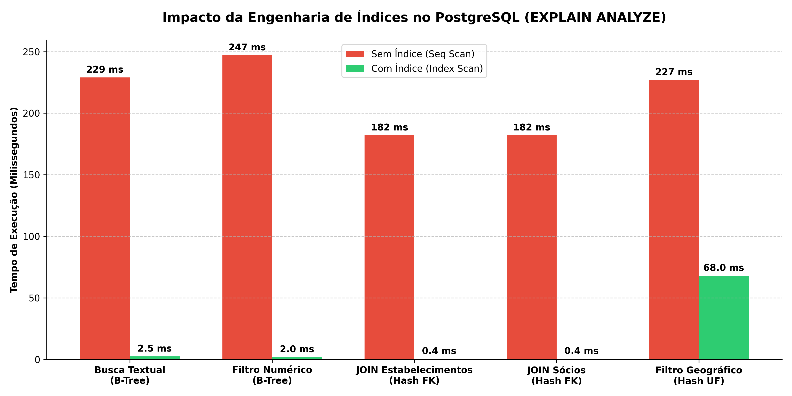

# 📊 Otimização e Análise de Desempenho de Índices PostgreSQL com a Base de Dados do CNPJ

**Autor:** Francisco Wesley Moreira de Oliveira  
**Curso:** Bacharelado em Sistemas de Informação — Centro Universitário Católica de Quixadá (UniCatólica)  
**Tecnologias:** PostgreSQL, SQL (B-Tree & Hash Indexes), Python (Streamlit, Pandas, Plotly, Psycopg2), Power BI e Metabase.

---

## 🎯 Objetivo do Projeto

Este projeto analisa na prática a modelagem relacional, o saneamento de dados e o impacto de estruturas de indexação física (**B-Tree** e **Hash**) no **PostgreSQL**, utilizando a base pública de dados do **Cadastro Nacional da Pessoa Jurídica (CNPJ)** disponibilizada pela Receita Federal do Brasil.

Além da otimização no banco de dados, foi construído um **Dashboard interativo em Python (Streamlit)** para consulta e visualização dos indicadores em tempo real.

---

## 🗄️ Arquitetura e Modelagem do Banco de Dados

A base de dados foi estruturada em três tabelas relacionais principais:

1. **`empresas` (Entidade Matriz):** Armazena os dados cadastrais base (`cnpj_basico` como Primary Key, `razao_social`, `natureza_juridica`, `capital_social` e `porte_empresa`).
2. **`estabelecimentos` (Unidades Físicas — Matrizes e Filiais):** Identificada pela chave primária composta (`cnpj_basico`, `cnpj_ordem`, `cnpj_dv`), contendo `nome_fantasia`, `situacao_cadastral`, `cnae_fiscal_principal`, `uf` e `municipio`, vinculada à tabela `empresas` via Foreign Key.
3. **`socios` (Quadro Societário - QSA):** Registra os sócios e administradores (`id_socio`, `cnpj_basico`, `nome_socio`, `cnpj_cpf_socio`, `qualificacao_socio`, `data_entrada_sociedade`, `faixa_etaria`), relacionada à tabela `empresas` via Foreign Key.

---

## ⚙️ Etapas Metodológicas Executadas

1. **Carga Inicial e Baseline (Tabelas Heap):** Importação inicial dos dados brutos sem restrições de chave estrangeira para evitar gargalos de escrita durante o processo de carga (ETL).
2. **Saneamento e Limpeza de Dados Órfãos:** Identificação e remoção de registros inconsistentes (filiais e sócios sem matriz correspondente na amostra) utilizando consultas `DELETE ... WHERE NOT EXISTS`, garantindo 100% de integridade antes da aplicação das *Foreign Keys*.
3. **Engenharia de Índices (B-Tree vs. Hash):**
   * **Índices B-Tree:** Aplicados em colunas de busca textual ordenada e filtros de intervalo numérico (`razao_social`, `capital_social` e chaves primárias).
   * **Índices Hash:** Aplicados em colunas de igualdade exata e chaves estrangeiras de junção (`uf`, `cnpj_basico`).
4. **Auditoria de Performance (`EXPLAIN ANALYZE`):** Comparação dos planos de execução (*Sequential Scan* vs. *Index Scan / Bitmap Index Scan*), reduzindo consultas de vários segundos para a casa de milissegundos.



---

## 📈 Dashboard Interativo em Python (Streamlit)

O arquivo [`dashboard/dashboard.py`](dashboard/dashboard.py) implementa um painel web interativo conectado diretamente ao PostgreSQL via `psycopg2`, contemplando 5 cenários de consulta:

1. **Ficha Cadastral (Busca Exata por CNPJ Básico)**
2. **Busca Textual por Razão Social (`ILIKE`)**
3. **Densidade Geográfica de Filiais por Estado (`UF`)** com gráficos em Plotly
4. **Consulta ao Quadro Societário (`JOIN` entre Empresas e Sócios)**
5. **Ranking e Análise de Capital Social**

---

## 📂 Estrutura do Repositório

```text
├── sql/
│   ├── schema_e_indices_cnpj.sql   # Script completo: DDL, limpeza de órfãos, PK/FK, índices B-Tree/Hash e EXPLAIN ANALYZE
│   └── consultas_e_testes.sql      # Consultas exploratórias e scripts de manipulação utilizados no laboratório
├── dashboard/
│   └── dashboard.py                # Aplicação interativa em Python (Streamlit + Pandas + Plotly + Psycopg2)
├── docs/
│   ├── Relatorio_Tecnico_CNPJ.md   # Relatório técnico detalhado da modelagem e otimização
│   ├── Relatorio_Tecnico_CNPJ.docx # Versão em Word do relatório técnico
│   └── Resumo_ABNT_CNPJ.docx       # Resumo acadêmico estruturado nas normas da ABNT (NBR 6028)
├── grafico_desempenho.png          # Comparativo visual do tempo de execução das consultas
└── README.md
```

---

## 🚀 Como Executar o Dashboard Localmente

1. Instale as dependências em Python:
   ```bash
   pip install streamlit pandas psycopg2-binary plotly
   ```
2. Configure as credenciais do seu banco PostgreSQL local no arquivo `dashboard/dashboard.py`.
3. Inicie a aplicação com o Streamlit:
   ```bash
   streamlit run dashboard/dashboard.py
   ```
